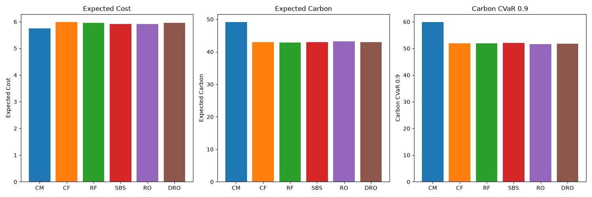
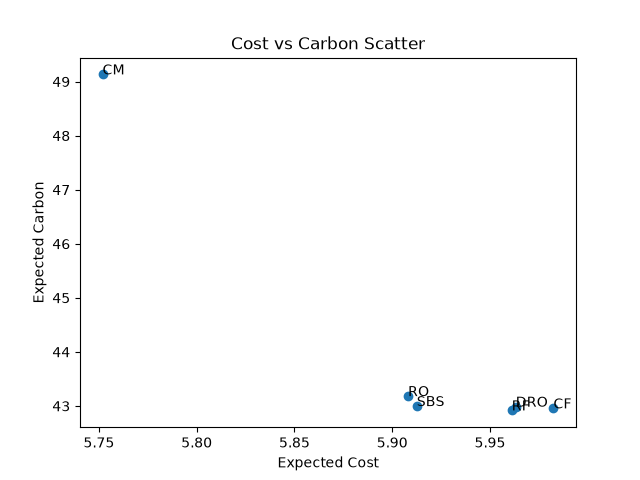
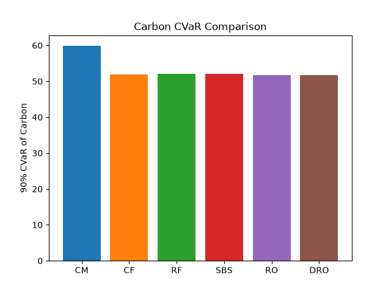

# Carbon DRO Paper Implementation

## Overview

This repository evaluates six carbon-aware cloud scheduling policies on a common WattTime/CAISO-derived experiment over 1,000 OOD scenarios.

## Research question

This experiment compares monetary cost, expected carbon, carbon CVaR 0.9, SLA violations and runtime across different scheduling policies.

## Six schedulers

| Scheduler | Description |
|-----------|-------------|
| CM | Cost-Minimizing |
| CF | Carbon-First |
| RF | Renewable-First |
| SBS | Score-Based Scheduler |
| RO | Robust Optimization using a 1.5-sigma safety margin |
| DRO | The original repository's greedy risk-adjusted operational DRO policy |

*Note: CVaR (Conditional Value at Risk) is evaluated separately as the mean carbon exposure in the worst 10 percent of outcomes. CVaR is an evaluation metric, not a scheduler.*

## Data and experiment

- authentic base date: 2025-08-05
- source region: CAISO_NORTH
- price source: CAISO day-ahead LMP
- Site 1: authentic price/carbon
- Site 2: price × 1.042 and carbon + 0.028 kg CO2/kWh
- Site 3: price × 0.969 and carbon − 0.018 kg CO2/kWh, clipped at zero
- renewable proxy: `clip(0.78 - normalized_carbon × 0.63, 0.15, 0.78)`
- I = 3
- T = 24
- J = 60
- S = 20
- n_ood = 1000
- seed = 42
- LSTM disabled
- greedy risk-adjusted DRO path
- input SHA-256: 178e62d33942632692cab8fd7b5fd8f707c0918478c5e6a06edb1d7fe4e743b7

## OOD protocol

The stress operations inherited from the original repository include:
- price level increase
- carbon level increase
- random price spikes
- random carbon spikes
- renewable reductions

Every method receives the identical stressed instance for a given OOD scenario.

## Results

CM:
cost 5.7519
carbon 49.1335
CVaR 59.8436
SLA 0.0

CF:
cost 5.9825
carbon 42.9551
CVaR 51.9403
SLA 0.0

RF:
cost 5.9611
carbon 42.9181
CVaR 51.9782
SLA 0.0

SBS:
cost 5.9126
carbon 42.9976
CVaR 52.0045
SLA 0.0

RO:
cost 5.9081
carbon 43.1828
CVaR 51.6351
SLA 0.0

DRO:
cost 5.9632
carbon 42.9864
CVaR 51.6870
SLA 0.0

## Paper comparison

| Method | Paper carbon reduction vs CM | Project carbon reduction vs CM |
|---|---|---|
| CM | 0.00% | 0.00% |
| CF | 11.88% | 12.57% |
| RF | 10.99% | 12.65% |
| SBS | 10.36% | 12.49% |
| RO | 10.29% | 12.11% |
| DRO | 11.75% | 12.51% |

| Method | Paper CVaR reduction vs CM | Project CVaR reduction vs CM |
|---|---|---|
| CM | 0.00% | 0.00% |
| CF | unavailable | 13.21% |
| RF | 10.96% | 13.14% |
| SBS | 10.36% | 13.10% |
| RO | 11.27% | 13.72% |
| DRO | 13.56% | 13.63% |

Findings:
- CM has the lowest cost and highest expected/tail carbon.
- All carbon-aware methods reduce expected carbon.
- Project DRO reduces expected carbon by 12.51% relative to CM.
- Project DRO reduces carbon CVaR by 13.63% relative to CM.
- Paper DRO reports a 13.56% CVaR reduction relative to CM.
- RO records the lowest project CVaR, narrowly ahead of DRO.
- All project methods record zero SLA violations.

## Plots







## Installation

```bash
python3 -m venv venv
source venv/bin/activate
python -m pip install --upgrade pip
python -m pip install -r requirements.txt
```

## Reproduce the experiment

```bash
python tools/run_phase13_six_method.py \
  --input artifacts/six_method_phase13_1000/selected_input_day.csv \
  --n-ood 1000 \
  --seed 42 \
  --output-dir reproduced_results
```

## Tests

```bash
python -m pytest tests/test_phase13_six_method.py \
  -q --tb=short -p no:cacheprovider
```

## Repository structure

- scheduler_v4_2.py
- tools/run_phase13_six_method.py
- tests/test_phase13_six_method.py
- docs/phase13_six_method_demo.md
- artifacts/six_method_phase13_1000/

## Reproducibility

This repository guarantees reproducibility by employing a fixed random seed, common inputs shared across all methods, a mathematically robust SHA-256 validation of instance parity, and a committed default CSV fixture (which can be overridden with the `PHASE13_PAPER_DAY` portable environment variable).
