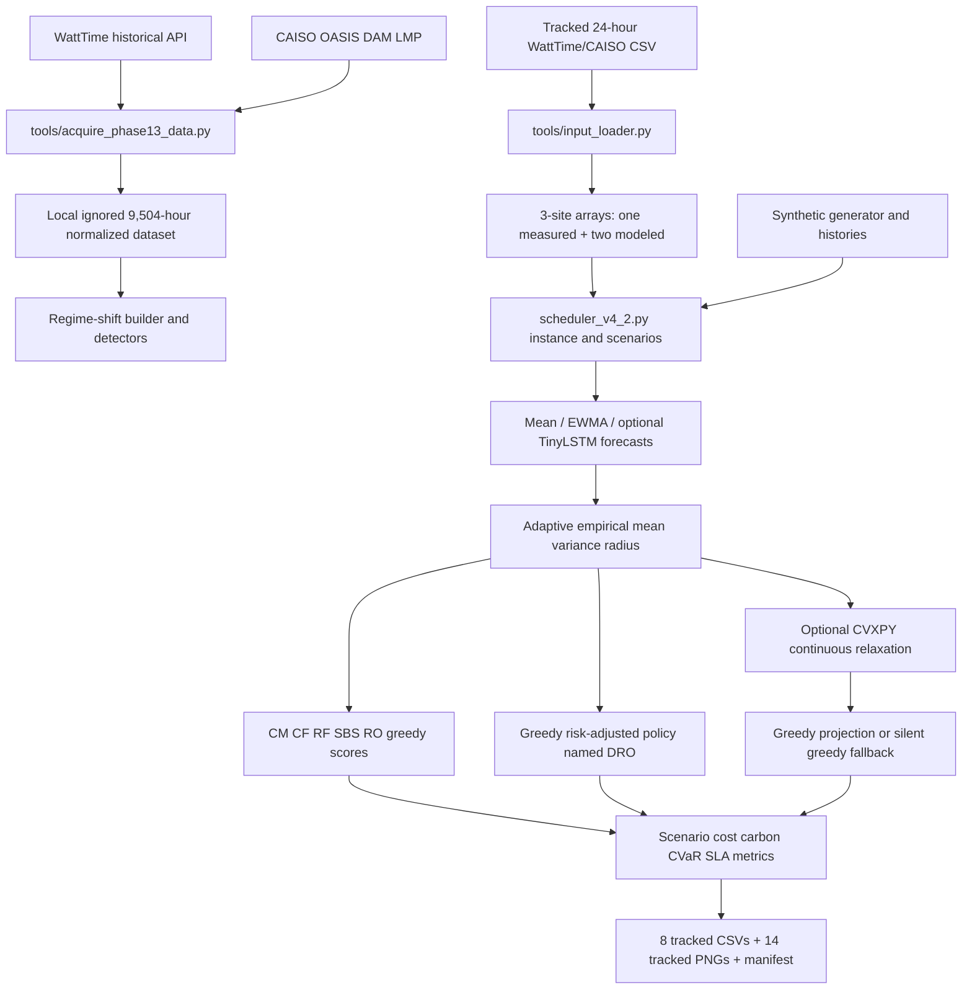

# CarbonDRO Full Implementation: Corrected Repository Evidence Report

**Purpose.** This document replaces `docs/base_paper_project_website_source.md` as the sole authoritative evidence source for future professor-facing presentation and website planning. The earlier report audited the wrong repository and is untrusted. This correction was produced on **26 October 2026** from the current `CarbonDROPaperImplementation` checkout only. It does not create a website or an Antigravity prompt.

**Correct repository root:** `/Users/siddharthbhakta/CarbonDROPaperImplementation`

**Origin:** <https://github.com/Sid-DudeD017/CarbonDROPaperImplementationFull.git>

**Active branch:** `team/clean-author-format-handoff`

**HEAD:** `3ce8fab3f7ba3987beb2ac75d387c997a6fe8db2` (`chore: remove superseded verification outputs`, 2026-10-12T23:45:52+05:30)

**Base paper:** Hardik Ruparel, “Carbon-aware scheduling and distributionally robust optimization for cloud systems: forecasting, battery storage, and adaptive ambiguity refinement,” *Journal of Cloud Computing* 15, article 84 (2026), <https://doi.org/10.1186/s13677-026-00904-7>.

## Executive verdict

This repository is a **working six-policy carbon-aware scheduling demonstrator with reproducible synthetic and semi-synthetic experiments**, not a complete implementation of the paper’s formal distributionally robust optimization method.

Its strongest evidence is:

- a tracked 24-hour WattTime/CAISO example input with a checksum and explicit transformations for two modeled sites;
- six implemented scheduling policies—CM, CF, RF, SBS, RO and a policy named DRO—run on common inputs;
- eight tracked result tables and fourteen tracked plots;
- exact reproduction of the tracked author-format tables, excluding inherently variable runtime fields;
- an independently rerun 1,000-case real-data/semi-synthetic six-method experiment;
- a local, ignored 9,504-hour WattTime/CAISO acquisition dataset with provenance metadata; and
- a local, ignored 48-scenario controlled regime-shift dataset and detector evaluation.

The central limitation is semantic: the accepted author-format run sets `dro_solver_mode` to `greedy`. Its “DRO” result is produced by a hand-designed risk-adjusted score, not by the paper’s Wasserstein/moment DRO, DRCC, mixed-integer formulation or Benders decomposition. The optional CVXPY path is a continuous relaxation followed by greedy projection, uses ad hoc robustness terms, can silently fall back to the greedy path, and is not the path used for the headline files.

The defensible professor-facing claim is therefore:

> We implemented and reproducibly evaluated six carbon-aware scheduling policies on synthetic workloads and a real CAISO/WattTime-derived day. The experiments reproduce the expected cost–carbon–tail-risk trade-off qualitatively. The current “DRO” policy is a risk-aware heuristic, so the repository does not yet constitute an exact reproduction of the paper’s formal DRO/DRCC/Benders algorithm.

Confidence labels used below:

- **Implemented:** executable code exists.
- **Tested:** an automated test exercises the behavior.
- **Experimentally verified:** an output was independently rerun during this audit.
- **Partially implemented:** some mechanism exists, but not the claimed/full mathematical method.
- **Missing:** no implementation exists in this checkout.
- **Local-only:** present in the current filesystem but ignored by Git, so absent from a clean clone.

---

# 1. Audit scope, repository identity and evidence rules

## 1.1 Repository identity proof

The following facts were read from Git inside the correct root:

| Item | Verified value |
|---|---|
| Absolute top level | `/Users/siddharthbhakta/CarbonDROPaperImplementation` |
| Origin fetch/push | `https://github.com/Sid-DudeD017/CarbonDROPaperImplementationFull.git` |
| Active branch | `team/clean-author-format-handoff` |
| HEAD | `3ce8fab3f7ba3987beb2ac75d387c997a6fe8db2` |
| Git common directory | `.git` inside this root |
| Worktree identity | one worktree at this same absolute root |
| Tracked files | 78 |
| Working-tree state before this report | clean |

Only one `.git` directory was found under the root after excluding the virtual environment and local datasets. The checkout is therefore a standalone repository, not a nested checkout or an attached worktree. No sibling directory, archived implementation or copied agent worktree was used for scientific claims.

The repository also has a `source-local` remote pointing to `/Users/siddharthbhakta/Carbon-Aware-Scheduler-main`. That path is the wrong repository used by the earlier audit. It was treated only as correction evidence and never as a source for the implementation or results in this report.

The active local branch is not shown as tracking an `origin/...` branch in `git branch -vv`; the origin’s default branch also points to an older branch. This does not invalidate the checkout, but it means the exact audited branch/commit should be pushed or tagged before external handoff.

## 1.2 Top-level directory inventory

| Directory | Role and audit status |
|---|---|
| `.deepeval/` | Evaluation configuration; not central to the scheduling experiments. |
| `.venv/` | Local ignored Python environment. |
| `artifacts/` | **Local-only** regime-shift manifests and detector results. |
| `author_format_outputs/` | **Tracked authoritative project-generated** CSVs, plots and run manifest. |
| `data/` | **Local-only** raw/intermediate/processed WattTime/CAISO data and regime inputs. |
| `docs/` | Four tracked handoff/audit/regime documents before this corrected report. |
| `example_data/` | Tracked 24-hour input used by the author-format and Phase-13 runners. |
| `local_outputs/` | **Local-only** smoke/rerun output. |
| `real_data_collection/` | Tracked compatibility/acquisition helper. |
| `reference_results_author/` | Tracked historical reference outputs from another revision; not current ground truth. |
| `regime_shift_csv/` | **Local-only** 48 CSV exports corresponding to controlled scenarios. |
| `schemas/` | Empty in the audited checkout. |
| `tests/` | Three tracked test modules, 25 test functions. |
| `tools/` | Input, acquisition, Phase-13 and regime-shift utilities. |

Root-level research files include `scheduler_v4_2.py` (the actual primary implementation), `scheduler.py` (an older prototype), `requirements.txt`, two READMEs, `.env.example`, `CITATION.cff` and repository configuration files.

There is **no `scheduler/` package, no current `website/` directory, no paper PDF, no slide deck, no DOCX report, and no exact-model artifact directory** in this checkout. Some README language describes a website, but that asset is not present at HEAD.

## 1.3 Actual research implementation

The operative implementation is:

1. `scheduler_v4_2.py` — 1,719-line experiment suite, data model, synthetic generator, forecast helpers, adaptive ambiguity state, six greedy policies, optional CVXPY relaxation, metrics, battery heuristic, plots and CLI.
2. `tools/input_loader.py` — strict loader and three-site transformation for the tracked day.
3. `tools/run_phase13_six_method.py` — focused six-method real-day runner.
4. `tools/acquire_phase13_data.py` — WattTime/CAISO acquisition, normalization and provenance.
5. `tools/build_regime_shift_dataset.py`, `tools/regime_shift_detect.py`, `tools/regime_shift_validate.py` and related tools — controlled shift creation and checking.
6. `scheduler.py` — older two-method prototype; retained, but not the generator of the accepted author-format outputs.

Evidence precedence for this report is: independent rerun > executable code > tracked machine-readable result > local-only artifact with checksum/provenance > documentation > filename or marketing claim. Matching a paper filename or trend is never treated as proof of algorithmic equivalence.

---

# 2. Project identity and completion status

The project studies deadline-constrained placement of jobs across regions and time slots using electricity price, marginal carbon intensity, renewable availability, capacity and uncertainty. It evaluates policies that emphasize cost, carbon, renewable use or robustness.

## 2.1 Completion matrix

| Component | Implemented | Tested | Experimentally verified | Correct status |
|---|---:|---:|---:|---|
| Six policy names CM/CF/RF/SBS/RO/DRO | Yes | Yes | Yes | Implemented as score-based/greedy operational policies |
| Capacity-aware job assignment | Yes | Partly | Yes | Greedy path can deliberately choose a least-overflow slot if no feasible slot exists |
| Expected cost/carbon metrics | Yes | Yes | Yes | Verified |
| Discrete scenario carbon CVaR | Yes | Partly | Yes | Evaluation metric; 10-scenario CVaR90 is the worst single scenario |
| SLA metric | Yes | Partly | Yes | Deadline/assignment counter only; does not validate capacity or richer SLA risk |
| TinyLSTM | Yes | No focused model-quality test | No accepted output | Implemented but inactive in accepted runs |
| EWMA fallback | Yes | Indirectly | No accepted headline use | Implemented; default accepted run actually uses scenario means |
| Adaptive ambiguity mean/variance/radius | Yes | Indirectly | Used by heuristic runs | Heuristic state, not a validated ambiguity guarantee |
| Greedy risk-adjusted “DRO” | Yes | Yes | Yes | This is the accepted headline method |
| CVXPY DRO-like path | Partly | No end-to-end correctness test | Not used in accepted output | Continuous relaxation + projection + ad hoc robust penalty |
| Exact binary MILP/MISOCP | No | No | No | Missing |
| Formal moment DRCC | No | No | No | Missing |
| Formal Wasserstein DRO/DRCC | No | No | No | Missing |
| Customized Benders decomposition | No | No | No | Missing |
| SLA-CVaR/DRCC | No | No | No | Missing |
| Network capacity/model | No | No | No | Missing |
| Battery state heuristic | Yes | Indirectly | Yes | Heuristic only; not jointly optimized in accepted run |
| Real-data day loader | Yes | Yes | Yes | Tracked and reproducible |
| Full 9,504-hour acquisition | Yes | Partly | Local files exist | Local-only; clean clone cannot reproduce without API access |
| 48 controlled regime shifts | Yes | Yes | Local artifacts exist | Structurally validated; detector benchmark failed consensus |
| Website | No at HEAD | No | No | Missing from current branch |

## 2.2 Readiness assessment

- **Professor presentation:** ready if framed as a reproducible heuristic implementation and gap analysis.
- **Website source:** this corrected report and `author_format_outputs/` are appropriate inputs; the wrong report is not.
- **Exact paper reproduction:** not ready.
- **Clean-clone reproducibility:** partial, because the tracked day and author outputs exist, but full acquired/regime data and result artifacts are ignored.
- **Publication-grade empirical evidence:** incomplete; there is one main run per configuration rather than replicated statistical inference over independent seeds.

---

# 3. Base paper: research question, architecture and claims

## 3.1 Research question

The paper asks how geo-distributed cloud jobs can be shifted across place and time to reduce carbon and tail risk without unacceptable electricity cost or SLA failure when forecasts and probability distributions are uncertain.

## 3.2 Paper method

The paper describes binary assignment variables, capacity and deadline constraints, grid/renewable energy, optional batteries, expected cost and carbon objectives, carbon and SLA CVaR, moment/Wasserstein distributionally robust chance constraints, LSTM/EWMA forecasts, adaptive ambiguity refinement and a customized Benders solution approach.

The paper compares six policies:

| Method | Intended paper meaning |
|---|---|
| CM | Cost minimization |
| CF | Carbon-first scheduling |
| RF | Renewable-first scheduling |
| SBS | Score-based scheduler |
| RO | Robust optimization |
| DRO | Distributionally robust optimization |

The correct expansion of SBS for this codebase is **score-based scheduler**. `docs/author_format_handoff.md` calls it “Scenario-Based Stochastic Optimization,” but the executable path is a score function, so that documentation label is unsupported.

## 3.3 Published target values

The journal paper’s headline comparative table reports:

| Method | Expected cost | Expected carbon (kg) | Carbon CVaR0.9 (kg) | SLA violation |
|---|---:|---:|---:|---:|
| CM | 24.79 | 101.07 | 119.88 | 0 |
| CF | 31.64 | 89.06 | 105.74 | 0 |
| RF | 30.27 | 89.96 | 106.74 | 0 |
| SBS | 29.55 | 90.60 | 107.46 | 0 |
| RO | 29.84 | 90.67 | 106.37 | 0 |
| DRO | 28.17 | 89.19 | 103.62 | 0 |

Thus the paper reports DRO CVaR 103.62 versus CM 119.88 (13.56% lower) and cost 28.17 versus 24.79 (13.64% higher). These are **paper values**, not reproduced repository results. The repository’s Phase-13 tool hardcodes these values for a comparison CSV; hardcoding them does not independently reproduce them.

---

# 4. Correct implemented architecture



The accepted author-format run follows the `N` path, not `O`.

## 4.1 Data and instance model

`scheduler_v4_2.Instance` contains regions (I), slots (T), jobs (J), scenarios (S), release/deadline vectors (a,d), processing demand (p), capacity (C), affine load-energy coefficients α and β, placement penalty (P_{ij}), scenario probabilities and scenario tensors for price, carbon and renewable supply. It also stores histories and optional battery parameters.

Synthetic instances generate job windows, capacities, site/temporal price-carbon patterns, renewable availability, and autoregressive histories/scenarios from NumPy random generators.

## 4.2 Forecast and ambiguity layer

`TinyLSTM` is a one-layer model with hidden size 32 and autoregressive rollout. `build_forecasts` behaves as follows:

- with `use_lstm=True` and PyTorch available: LSTM for price/carbon and EWMA for renewables;
- with `use_lstm=True` but no PyTorch: EWMA fallback;
- with `use_lstm=False`: scenario means are used, even though console text calls the mode “mean/ewma.”

The tracked author manifest uses the default CLI without `--use-lstm`, so no LSTM result is established. PyTorch is not explicitly seeded inside this module, so deterministic LSTM training is also not established.

`AdaptiveAmbiguitySet.from_samples` computes element-wise empirical mean and variance and sets a radius to the 90th percentile of sample Euclidean distance. Updates are exponential moving averages. `adaptive_refine` feeds synthetic scenario observations for a small number of epochs; it is not a chronological leakage-audited online controller.

`robust_forecast_from_ambiguity` creates conservative forecasts through maxima, means, standard deviations and a `0.01 * radius` term. It does not solve a Wasserstein optimization problem.

## 4.3 Scheduling layer

The greedy scheduler sorts feasible site/time candidates by a method-specific score and places each job once in its release/deadline window. When no candidate has enough capacity, it still assigns the job to a least-overflow slot. Therefore every job can appear scheduled and the reported SLA can remain zero while capacity is violated.

The six accepted policies are operational scores:

- **CM:** expected price emphasis;
- **CF:** carbon emphasis;
- **RF:** price/carbon plus renewable preference;
- **SBS:** weighted score blend;
- **RO:** mean plus standard-deviation conservatism;
- **DRO:** weighted price, carbon and risk-adjusted forecast score.

These are useful comparative heuristics. Only the names correspond to the paper’s method categories; the implementations are not equivalent to all paper optimization formulations.

## 4.4 Optional CVXPY layer

`solve_dro_cvxpy` uses continuous (x_{ijt}\in[0,1]), not binary decisions. It models load, grid, renewable and optional battery variables; includes a scenario CVaR epigraph; adds an L2 robust penalty; and tries CLARABEL, SCS, ECOS and OSQP. It then projects the fractional assignment through a greedy pass and recomputes energy. If solving fails, it silently returns the greedy DRO policy.

Consequences:

- no mixed-integer optimality is established;
- no optimality gap is reported;
- projected decisions need not retain relaxation guarantees;
- optimized battery variables are not preserved through projection;
- the returned metrics do not identify which solver/path actually executed; and
- this path is not used by the accepted `author_format_outputs`.

## 4.5 Battery layer

The accepted battery experiment starts at 50% state of charge, uses 25th/75th carbon thresholds, charges or discharges up to 0.8 of a rate limit, and updates state with efficiency 0.92. The result explicitly says `carbon_threshold_heuristic` and “NOT full DRO joint optimisation.” This qualification must remain visible.

---

# 5. Mathematical model actually implemented

## 5.1 Intended assignment and capacity

For binary-like greedy assignments (x_{ijt}\in\{0,1\}), the intended relations are:

\[
\sum_i\sum_{t=a_j}^{d_j}x_{ijt}=1,
\qquad
\sum_j p_jx_{ijt}\le C_{it}.
\]

The first is enforced by construction. The second is attempted but may be exceeded by the least-overflow fallback.

## 5.2 Energy model

Load and energy are:

\[
\ell_{it}=\sum_j p_jx_{ijt},
\qquad
\phi_{it}=\alpha_{it}+\beta_{it}\ell_{it}.
\]

Renewable energy is clipped by available renewable capacity and grid energy supplies the remainder:

\[
r_{it}=\min(\phi_{it},\bar r_{it}),
\qquad g_{it}=\phi_{it}-r_{it}.
\]

Expected scenario cost and carbon are weighted sums of scenario price/carbon times (g).

## 5.3 Reported CVaR

For scenario losses sorted ascending, the evaluator averages the worst

\[
k=\max(1,\lceil(1-\beta)S\rceil)
\]

values. This is a discrete empirical tail mean. With (S=10), CVaR0.9 and CVaR0.95 both reduce to the single worst scenario. With (S=20), CVaR0.9 averages two scenarios while CVaR0.95 uses one.

The comparative/real tables report a CVaR computed within each generated 10- or 20-scenario instance and then average that statistic across repeated generated instances. It is not a single CVaR over 1,000 fixed-schedule out-of-sample losses.

## 5.4 Heuristic risk score

The greedy DRO score has the generic form

\[
s_{itj}=w_p\hat p_{it}+w_c\hat c_{it}
 +w_r(\mu^c_{it}+\tau\sigma^c_{it})
 +w_{place}P_{ij}-w_{ren}\hat r_{it},
\]

with hand-set weights. This is risk-adjusted scoring. It is not the dual or reformulation of a distributionally robust optimization problem.

## 5.5 CVXPY surrogate

The optional relaxation includes the standard scenario CVaR epigraph

\[
\eta+\frac{1}{1-\beta}\sum_s q_s\xi_s,
\qquad \xi_s\ge L_s-\eta,\quad\xi_s\ge0,
\]

and an ad hoc carbon tightening/penalty using norms of grid energy. There is no implemented ambiguity-set duality, formal moment DRCC, exact Wasserstein ball, SLA risk model or Benders master/subproblem decomposition.

## 5.6 SLA metric boundary

The reported SLA violation rate counts unscheduled jobs or assignments beyond the stored deadline. Because candidates are created only inside each window and the fallback uses the deadline, the metric is structurally driven to zero. It does not detect capacity overflow, response-time latency, network congestion or probabilistic SLA violations. Zero in the result tables is therefore not proof of broad SLA safety.

---

# 6. Datasets and provenance

## 6.1 Tracked canonical day

`example_data/paper_day_2025-08-05.csv` contains 24 hourly records from `2025-08-05T07:00:00Z` through `2025-08-06T06:00:00Z` with SHA-256:

`39c647650ff845acc4eb0eafd279ac400b6c5c3ba9bfe1c1393d241475924c50`

Site 1 is documented as WattTime CAISO_NORTH MOER paired with CAISO OASIS DAM LMP at `TH_NP15_GEN-APND`. The loader constructs:

- Site 2: price × 1.042, carbon + 0.028;
- Site 3: price × 0.969, carbon − 0.018 clipped at zero; and
- renewable proxy: (0.78-0.63\times\) normalized carbon, clipped to [0.15, 0.78].

Thus only one site’s price/carbon series is observed; two sites and all renewables are modeled. Jobs, capacities, histories and OOD perturbations are synthetic.

## 6.2 Local full acquisition dataset

The ignored local file `data/data_collected/processed/grid_normalized.csv` exists and its metadata reports:

| Property | Value |
|---|---:|
| Site | `CAISO_NP15` |
| UTC interval | 2024-08-01 07:00 to 2025-09-01 06:00 |
| Hourly rows | 9,504 |
| Carbon source | WattTime CAISO_NORTH MOER |
| Price source | CAISO DAM `TH_NP15_GEN-APND` |
| Normalized checksum | `87b074e0a990ed19a861ad85f7ed1207ba19ac4fece73a4b9899f620c1a1f109` |
| Raw WattTime observations | 114,062; 114,049 unique; 13 identical duplicates |
| Complete/incomplete carbon hours | 9,504 / 1 |
| Interpolations | 0 |
| Negative price hours | 293 |
| Carbon min/mean/max | 0 / 0.336520 / 0.558482 kg/kWh |
| Price min/mean/max | −0.038471 / 0.038319 / 0.487430 USD/kWh |

The acquisition converts lb/MWh to kg/kWh using `0.45359237 / 1000` and USD/MWh to USD/kWh using `/1000`. It requires all 12 five-minute carbon observations per hour.

The acquisition metadata partitions train at 2024-08-01 07:00–2025-07-01 07:00, validation at 2025-07-01 07:00–2025-08-01 07:00, and test at 2025-08-01 07:00–2025-09-01 07:00. These are acquisition partitions, not the later regime-tool partitions.

All full raw, intermediate and processed files are ignored by `.gitignore`; a clean clone will not contain them. API credentials, network access and provider availability are required to reacquire them. The tracked `requirements.txt` also omits `python-dotenv`, `pyarrow` and `ruptures`, despite tools using those packages.

## 6.3 Regime-shift dataset

The regime tool uses different splits:

| Partition | Rows | Actual interval |
|---|---:|---|
| Calibration | 6,545 | 2024-08-01 07:00–2025-04-30 23:00 UTC |
| Validation | 1,464 | 2025-05-01 00:00–2025-06-30 23:00 UTC |
| Held out | 1,495 | 2025-07-01 00:00–2025-09-01 06:00 UTC |

Forty-eight controlled scenarios exist locally: 16 transformation configurations at each 25%, 50% and 75% injection position. Families cover abrupt carbon/price mean shifts, carbon/price variance shifts, 24/168-hour gradual carbon drift, a 72-hour recurring carbon regime and compound carbon/price shifts.

Structural validation marks all 48 valid for row/timestamp/site consistency, pre-τ invariance and unaffected-column invariance. It does **not** demonstrate detector success. `artifacts/regime_shift/detection_results.csv` records `one_detector_only` for all 48, no consensus τ estimate, `missed_detection=True` for all 48, and zero detections within 6, 24 or 72 hours. The `transformation_realization_error` column is fixed at 0.0 and is not evidence of a computed error analysis.

The WattTime access report is internally inconsistent: its top-level fields say no CAISO_NORTH access and no historical bounds, while embedded metadata and a 2025 request show an HTTP 200 response. It should be presented as partially/inconsistently recorded, not as a definitive access guarantee.

---

# 7. Experimental methodology

## 7.1 Canonical author-format run

The tracked manifest corresponds to:

```bash
python scheduler_v4_2.py \
  --out author_format_outputs \
  --input example_data/paper_day_2025-08-05.csv \
  --n-bench 1000 \
  --n-real 100 \
  --dro-solver greedy \
  --seed 7
```

Its comparative dimensions are (I=4,T=24,J=100,S=10). Its real-day dimensions are (I=3,T=24,J=60,S=20). It uses common inputs for all six policies within each generated instance.

Important interpretation: `run_comparative_benchmark` loops 1,000 times, creates and stresses a fresh instance each time, rebuilds forecasts/ambiguity and reschedules all methods. It does not compute one schedule and evaluate it against 1,000 unseen outcomes. The reported row is an average of per-instance metrics.

The real-day experiment likewise creates a base semi-synthetic instance and, for each OOD repetition, stresses it, rebuilds the forecast and reschedules. It is not a fixed-policy deployment test.

## 7.2 Focused Phase-13 run

`tools/run_phase13_six_method.py` loads the tracked day, forces `use_lstm=False` and `dro_solver="greedy"`, and emits aggregate, comparison, configuration and plot files.

Its `--seed` argument is stored in configuration and included in a composite checksum, but it is not passed to `run_real_data_experiment`; that function uses its own fixed base/OOD seeds. Changing this CLI seed therefore does not change the experimental values. This is a provenance bug.

## 7.3 Author/reference separation

`author_format_outputs/` and `reference_results_author/` have matching filename conventions, but none of their eight CSVs are exactly equal and the Pareto tables even differ in shape. The reference directory explicitly belongs to earlier/different revisions. It is a visual/schema reference, not evidence for current numbers.

## 7.4 Statistical boundary

The result tables contain means and scenario standard deviations but no confidence intervals or hypothesis tests over independent experimental seeds. The 1,000 loop count should not be marketed as 1,000 independent replications of one fixed scheduler policy.

---

# 8. Verified numerical results

## 8.1 Independently reproduced canonical comparative benchmark

The full author command was rerun in an isolated clone of the exact HEAD. All non-runtime fields below reproduced the tracked CSV exactly.

| Method | Expected cost | Expected carbon | CVaR0.9 carbon | SLA rate |
|---|---:|---:|---:|---:|
| CM | 15.513932 | 67.103480 | 79.595913 | 0 |
| CF | 19.165627 | 54.015885 | 64.120738 | 0 |
| RF | 17.362390 | **52.538504** | **62.402410** | 0 |
| SBS | 17.451114 | 56.516114 | 66.937952 | 0 |
| RO | 17.843955 | 56.374655 | 65.967371 | 0 |
| DRO | 18.764723 | 54.527990 | 64.379747 | 0 |

CM has the lowest cost; RF, not DRO, has the lowest carbon and CVaR. Relative to CM, the greedy DRO row costs **20.9540% more**, emits **18.7404% less** expected carbon and has **19.1168% lower** reported CVaR.

## 8.2 Independently reproduced canonical real-day benchmark, 100 OOD loops

| Method | Expected cost | Expected carbon | CVaR0.9 carbon | SLA rate |
|---|---:|---:|---:|---:|
| CM | **5.747195** | 49.066306 | 59.630360 | 0 |
| CF | 5.984134 | **42.933565** | 51.796682 | 0 |
| RF | 5.965665 | 42.940829 | 51.891391 | 0 |
| SBS | 5.915428 | 42.948041 | 51.840446 | 0 |
| RO | 5.911828 | 43.106181 | **51.475497** | 0 |
| DRO | 5.966557 | 42.952327 | 51.525810 | 0 |

CM has the lowest cost, CF the lowest expected carbon and RO the lowest reported CVaR. DRO is not best on any of the three objectives. Relative to CM, DRO costs **3.8169% more**, emits **12.4606% less** expected carbon and has **13.5913% lower** reported CVaR.

## 8.3 Independent focused Phase-13 run, 1,000 OOD loops

This audit also ran `tools/run_phase13_six_method.py` with `n_ood=1000` against the tracked day:

| Method | Expected cost | Expected carbon | CVaR0.9 carbon |
|---|---:|---:|---:|
| CM | **5.751860** | 49.133500 | 59.843585 |
| CF | 5.982461 | 42.955085 | 51.940269 |
| RF | 5.961136 | **42.918099** | 51.978228 |
| SBS | 5.912571 | 42.997640 | 52.004463 |
| RO | 5.908116 | 43.182817 | **51.635099** |
| DRO | 5.963185 | 42.986364 | 51.687035 |

All SLA values are 0. Relative to CM, DRO costs **3.6740% more**, emits **12.5111% less** expected carbon and has **13.6298% lower** reported CVaR. RF has lowest mean carbon and RO lowest CVaR.

## 8.4 Other tracked results

- Illustrative baseline: cost 2.923966, carbon 12.590672, CVaR 14.867544.
- Illustrative greedy DRO: cost 3.614482, carbon 10.660400, CVaR 12.627714.
- Battery heuristic: cost 19.799474, carbon 59.391970, renewable utilization 0.360982, CVaR0.9 71.854745.
- The Pareto CSV retains only two non-dominated points. It is an illustration, not a dense or statistically validated Pareto frontier.
- The sensitivity grid frequently repeats exactly across τ/weight settings, reflecting discrete score rankings. It does not show smooth parameter identification.
- Runtime values are millisecond-scale policy execution timings and vary across reruns. They should not be compared with exact optimization runtimes in the paper.

## 8.5 Numerical comparison with the paper

The project’s real-day DRO-vs-CM CVaR reduction (about 13.6%) resembles the paper’s 13.56%, but the absolute values, data construction, scheduler, scenario semantics and objective path differ. Similar percentage reduction is not proof of reproduction. Website/presentation tables must place “Published paper” and “This repository” side by side with distinct labels.

---

# 9. Code execution and test evidence

## 9.1 Safe audit method

To obey the requirement not to modify source, data, experiments or configuration, execution was performed in a temporary clone of the correct HEAD and results were written under `/tmp`. The correct checkout was left unchanged except for this report.

## 9.2 Rerun outcomes

- Full `scheduler_v4_2.py` author-format command: completed successfully in about 25 seconds; all non-runtime metrics matched tracked author outputs.
- Direct focused Phase-13 smoke run: completed successfully.
- Direct focused Phase-13 1,000-loop run: completed successfully and produced the values in Section 8.3.
- `tests/test_author_format_exporter.py` plus `tests/test_regime_shift.py`: **18 passed**.
- Full scoped `pytest tests` after copying the checkout’s ignored regime artifacts into the temporary clone: **20 passed, 2 failed, 3 errors**.

The five Phase-13 failures/errors arise when tests spawn the runner as a subprocess; the subprocess terminates with `SIGABRT` in this macOS/Python 3.14 environment. Running the same runner directly succeeds. This is a real test-suite portability/integration failure and should not be reported as “all tests pass.”

Without the ignored `artifacts/regime_shift/watttime_access_report.json`, one additional test fails/errors, so the tracked suite is not self-contained in a clean clone.

## 9.3 Reproduction commands

```bash
# Canonical tracked output configuration
MPLCONFIGDIR=/tmp/carbon_mpl .venv/bin/python scheduler_v4_2.py \
  --out /tmp/carbon_author_rerun \
  --input example_data/paper_day_2025-08-05.csv \
  --n-bench 1000 --n-real 100 --dro-solver greedy --seed 7

# Focused 1,000-loop real-day comparison
MPLCONFIGDIR=/tmp/carbon_mpl .venv/bin/python tools/run_phase13_six_method.py \
  --input example_data/paper_day_2025-08-05.csv \
  --n-ood 1000 --seed 42 --output-dir /tmp/carbon_phase13_rerun

# Tests that pass independently in the audited environment
MPLCONFIGDIR=/tmp/carbon_mpl .venv/bin/python -m pytest \
  tests/test_author_format_exporter.py tests/test_regime_shift.py -q
```

---

# 10. Visual and machine-readable asset manifest

## 10.1 Authoritative tracked output set

`author_format_outputs/` contains:

| Asset | Rows / role | Status |
|---|---|---|
| `run_manifest.json` | input checksum, dimensions, seeds, OOD counts, provenance, greedy mode | Tracked and authoritative for configuration |
| `metrics_comparative.csv` | 6 methods, 1,000 generated/stressed instances | Rerun verified |
| `metrics_real_data.csv` | 6 methods, 100 real-day/semi-synthetic loops | Rerun verified |
| `metrics_illustrative.csv` | 2 rows | Rerun verified as part of full command |
| `metrics_scale_sweep.csv` | 36 rows | Rerun verified |
| `metrics_sensitivity.csv` | 24 rows | Rerun verified |
| `metrics_battery.csv` | 1 heuristic row | Rerun verified |
| `metrics_pareto.csv` | 2 retained points | Rerun verified |
| `metrics_compute_cost.csv` | 30 timing rows | Structure verified; runtimes inherently variable |

## 10.2 Fourteen tracked plots

All are under `author_format_outputs/plots/` and were visually/file inspected:

1. `plot1_comparative_barplot.png` — six-method cost/carbon/CVaR/SLA bars.
2. `plot2_cost_carbon_scatter.png` — cost–carbon positions.
3. `plot3_pareto_frontier.png` — two retained Pareto points.
4. `plot4_temporal_heatmap.png` — scheduled grid-energy heatmap.
5. `plot5_renewable_utilization.png` — renewable profile/utilization.
6. `plot6_battery_dynamics.png` — heuristic battery state/dispatch.
7. `plot7_cvar_analysis.png` — tail metric across scales.
8. `plot8_sensitivity_heatmap.png` — score-weight sensitivity.
9. `plot9_uncertainty_quantification.png` — scenario/forecast uncertainty illustration.
10. `plot10_violin_distribution.png` — distribution illustration.
11. `plot11_convergence_analysis.png` — ambiguity-radius heuristic convergence.
12. `plot12_job_scheduling_gantt.png` — allocation visualization.
13. `plot13_real_data_comparison.png` — real-day six-method comparison.
14. `plot14_compute_cost.png` — measured policy runtime scaling.

The plot filenames mirror paper-style themes, but labels such as “Wasserstein convergence” must be qualified because the code updates an empirical heuristic radius rather than solving a validated Wasserstein DRO program.

## 10.3 Non-authoritative assets

`reference_results_author/` contains eight historical CSVs and the same fourteen plot names plus `reference.md`. These outputs are from earlier/different revisions and are not numerically equal to current author outputs. They may be used only for historical comparison.

Local-only full data, 48 regime Parquet/CSV scenarios and regime manifests are genuine current-filesystem assets, but they are ignored by Git and cannot be assumed present for another user.

---

# 11. Key concepts for a professor-facing explanation

1. **Carbon-aware scheduling:** move flexible computation to cleaner sites/times while meeting job windows.
2. **Cost–carbon trade-off:** CM is cheapest; lower-carbon policies accept a cost premium.
3. **Tail risk/CVaR:** average the most adverse scenario losses rather than only the mean.
4. **Distribution shift:** future conditions can differ from historical/scenario assumptions.
5. **DRO:** optimize against a family of probability distributions—not merely add a standard-deviation score. This distinction is the repository’s main gap.
6. **Ambiguity set:** a set of plausible distributions or moments. The project estimates mean/variance/radius, but does not implement the full formal robust counterpart.
7. **Forecast fallback:** sophisticated models are useful only when trained and validated; accepted results use means, not LSTM.
8. **Real vs modeled data:** one measured site-day becomes three modeled sites, with a derived renewable proxy and synthetic jobs/OOD scenarios.
9. **Reproducibility:** checksums and manifests are strengths; ignored full datasets and dependency gaps are weaknesses.
10. **Feasibility vs reported SLA:** assigning every job within a window is not enough if capacity can overflow.
11. **Negative results:** RF/RO sometimes beat the named DRO policy, and the regime detector misses all 48 consensus cases.
12. **Research value:** transparent limitations and reproducible baselines create a credible foundation for a future exact implementation.

## 11.1 Suggested one-minute explanation

> The base paper proposes an exact, uncertainty-aware cloud scheduler combining forecasts, distributionally robust risk constraints and battery management. This repository implements the experimental skeleton and six operational policies using synthetic workloads and CAISO/WattTime-derived signals. We can reproduce its own tables and show a clear trade-off: the lowest-cost policy emits more, while risk-aware policies reduce mean and tail carbon at a modest cost premium. However, the current accepted “DRO” is a greedy risk-adjusted score, not the paper’s exact DRO/DRCC/Benders solver. Our contribution at this stage is a transparent, reproducible comparative prototype and a precise roadmap to close that mathematical gap.

## 11.2 Questions to be ready for

- Why call the method DRO if it is a score heuristic? Answer honestly: it is the repository’s legacy label; the report relabels it “greedy risk-adjusted DRO policy.”
- Are all three sites real? No: one series is measured, two are deterministic transformations.
- Are renewables measured? No: they are a carbon-derived proxy.
- What does 1,000 OOD mean? 1,000 regenerate/stress/reschedule loops, not one schedule tested on 1,000 outcomes.
- Why is SLA always zero? Scheduling is constrained to windows and the metric is narrow; capacity overflow is not included.
- Is the LSTM used? Not in the accepted results.
- Which method wins? CM on cost; RF/CF often on mean carbon; RO/RF often on CVaR; the named DRO gives a compromise but is not uniformly best.
- Is regime detection successful? No consensus detection succeeds in the local 48-case output.

---

# 12. Paper-to-implementation gap analysis

| Paper element | Correct repository evidence | Verdict |
|---|---|---|
| Six policy comparison | All six names run on common instances | Implemented, but algorithm meanings are simplified |
| Binary scheduling | Greedy produces one-hot schedules; CVXPY uses continuous relaxation | Partial, not exact optimization |
| Cost/carbon objective | Scores and relaxed objective | Implemented |
| Carbon CVaR | Evaluated; epigraph in optional relaxation | Partial; no accepted exact integer CVaR solve |
| SLA risk/CVaR | Narrow post-hoc deadline counter | Missing paper risk formulation |
| Moment DRCC | No formal implementation | Missing |
| Wasserstein DRO | Heuristic radius and norm penalties only | Missing formal method |
| Adaptive ambiguity | Mean/variance/radius heuristic | Partial |
| LSTM/EWMA | Code exists | Implemented but not headline-tested/used |
| Battery | Threshold heuristic; optional relaxed variables discarded after projection | Partial |
| Benders decomposition | No source in current checkout | Missing |
| 1,000 OOD | 1,000 fresh regenerate/reschedule loops | Implemented with different semantics |
| Real multi-region data | One real series + two modeled sites + renewable proxy | Partial/semi-synthetic |
| Feasibility guarantee | Greedy overflow fallback; no independent validator | Missing robust guarantee |
| Statistical evidence | Means/std; no replicated confidence analysis | Limited |

The repository’s README and handoff sometimes call the project “end-to-end” and “adaptive Wasserstein.” Those labels overstate the executable evidence and should not appear unqualified on a professor-facing site.

---

# 13. Implementation gaps and prioritized next work

## Critical scientific gaps

1. Implement a binary MILP/MISOCP with explicit feasibility validation.
2. Specify and implement the actual moment and/or Wasserstein ambiguity model and DRCC.
3. Implement carbon and SLA CVaR consistently with the paper.
4. Add Benders master/subproblem logic only after the monolithic reference is validated.
5. Evaluate a fixed learned/scheduled policy over held-out scenarios, not only regenerate and reschedule.
6. Report solver status, fallback status, integrality, constraint residuals and optimality gap.
7. Replace narrow SLA reporting with deadline, capacity and service-level checks.

## Reproducibility gaps

1. Track or release checksummed normalized datasets and regime artifacts under an explicit data policy.
2. Add `pyarrow`, `ruptures` and `python-dotenv` to the environment specification where required.
3. Fix Phase-13 subprocess test aborts and remove dependence on ignored artifacts.
4. Pass CLI seed values into actual experiment generators.
5. Record software versions, hardware and solver path in manifests.
6. Resolve the stale `CITATION.cff` repository URL, which omits `Full`.
7. Push/tag the audited branch/commit on origin.

## Experiment gaps

1. Use multiple independent seeds with confidence intervals and paired comparisons.
2. Separate scenario count inside CVaR from the number of experimental/OOD repetitions.
3. Validate LSTM forecast quality against EWMA/persistence before using it in scheduling.
4. Repair and benchmark regime detectors; current consensus success is 0/48.
5. Add measured multi-region carbon, price and renewable data if claims require geography.

---

# 14. Website/presentation evidence priorities (planning source only)

No website is generated by this task. A later website should prioritize evidence in this order:

1. **Hero verdict:** reproducible six-policy prototype, not exact paper reproduction.
2. **Paper vs project table:** clearly separate published values from project values.
3. **Architecture:** show measured data, modeled transformations, synthetic jobs, heuristic policies and output layer.
4. **Verified result cards:** use the reproduced tables in Section 8, with CM/RF/RO winners labeled accurately.
5. **Method truth panel:** “accepted DRO path = greedy risk-adjusted score.”
6. **Data provenance:** one observed site, two modeled sites, derived renewables, synthetic OOD/workloads.
7. **Visual gallery:** use the 14 `author_format_outputs/plots` assets with corrected captions.
8. **Reproduction panel:** commands, checksums, branch and commit.
9. **Limitations/roadmap:** exact DRO, DRCC, Benders, feasibility validation and statistical evaluation.
10. **Negative evidence:** Phase-13 test portability failure and 0/48 consensus regime detections.

Do not use the wrong repository’s static website, exact-solver graphics, Phase-15 dashboard, 489-test badge or exact numerical artifacts.

---

# CORRECTION AUDIT

## Which incorrect repository/folders were previously examined?

The prior report explicitly audited `/Users/siddharthbhakta/Carbon-Aware-Scheduler-main`, branch `main`, commit `e229c1d79014952218ae75e628463fedf0923bc7`. It also incorporated that repository’s untracked work/output directories, newer `scheduler/` package, exact-model artifacts and static website. Those belong to a different repository and cannot describe the current project.

## What is the correct repository root?

`/Users/siddharthbhakta/CarbonDROPaperImplementation`, with origin `CarbonDROPaperImplementationFull.git`, branch `team/clean-author-format-handoff`, HEAD `3ce8fab3f7ba3987beb2ac75d387c997a6fe8db2`.

## Which previous claims remain valid after independent verification?

- The 2026 journal paper identity and its published headline values.
- The broad research topic: cost/carbon/risk-aware cloud scheduling.
- This correct repository contains `scheduler_v4_2.py`, six policy labels, LSTM/EWMA code, adaptive empirical ambiguity updates, a battery heuristic, real-data acquisition code, eight author-format CSVs and fourteen plots.
- The project has a 9,504-hour local WattTime/CAISO dataset and 48 local controlled regime scenarios—but these are ignored, local-only assets.
- The project should be presented as incomplete relative to the paper.

These statements remain valid because they were re-established from the correct root, not because they appeared previously.

## Which previous claims are incorrect or unsupported here?

The following prior-report claims have no supporting files in the correct current checkout and are removed:

- a modern `scheduler/` package with typed scientific contracts;
- an exact binary monolithic MILP/MISOCP as the current implementation;
- independently validated exact CVaR/DRCC results;
- HiGHS/ECOS_BB reference executions with objectives 436.869461, 1017.662709 and 441.581343;
- robust LHS 1062.240333 and CVaR 513.684847 as this project’s accepted evidence;
- leakage-safe online controller and exact independent solution validator;
- Phase-15 30-seed normal/shifted aggregate results;
- a 489-passed scoped test suite;
- a current static `website/` implementation and dashboard JSON;
- an integrated or separately validated Benders implementation;
- exact Wasserstein/moment DRCC and SLA-CVaR support;
- the previously described five-job, 744-slot exact real-data experiment; and
- paper-scale exact reproduction status.

The earlier claim that relevant raw/current datasets were absent is also wrong for this filesystem: the correct checkout has the full local data and regime artifacts. The corrected qualification is that they are **present locally but ignored and absent from a clean clone**.

## Which numerical results changed?

All wrong-repository exact and Phase-15 numbers are deleted from the authoritative narrative. The correct repository’s authoritative/rerun values are those in Section 8:

- synthetic author-format CM/DRO: cost 15.513932/18.764723, carbon 67.103480/54.527990, CVaR 79.595913/64.379747;
- real-day 100-loop CM/DRO: cost 5.747195/5.966557, carbon 49.066306/42.952327, CVaR 59.630360/51.525810; and
- focused real-day 1,000-loop CM/DRO: cost 5.751860/5.963185, carbon 49.133500/42.986364, CVaR 59.843585/51.687035.

Published paper numbers remain paper numbers and did not change.

## Which actual assets and experiments exist?

- Tracked: primary/legacy source, twelve tools, three test modules, one example CSV, eight author result CSVs, fourteen author plots, run manifest, eight historical reference CSVs and fourteen historical reference plots.
- Local-only: complete acquisition raw/intermediate/processed data, 48 regime Parquet files, 48 regime CSVs, regime manifests/detection results and smoke outputs.
- Executed in this audit: full canonical author run, direct Phase-13 smoke/full runs and focused/full tests in a temporary clone.
- Absent: current website, exact solver package/artifacts, paper PDF, presentation deck and full formal DRO/Benders results.

## Correct implementation and reproduction status

The six greedy policies, output generation, tracked day ingestion, synthetic/semi-synthetic experiments and plots are implemented and reproducible. The local acquisition/regime construction is implemented and partially tested, but not clean-clone reproducible. The named DRO policy is experimentally verified as a heuristic. The formal paper optimization, DRCC, Benders, exact battery integration, SLA risk and paper-scale empirical reproduction are missing.

---

# VERIFIED FACTS

- Repository identity, root, remote, branch and commit were read directly from the correct `.git` directory.
- `scheduler_v4_2.py` generates the tracked author-format outputs.
- Accepted output mode is `dro_solver_mode: greedy` and LSTM is not enabled.
- The tracked input checksum, row count and time range match the manifest.
- The author-format numerical values reproduce in an isolated clone.
- One observed site is transformed into two modeled sites; renewable fraction is derived.
- The benchmark recreates/reschedules instances rather than evaluating one fixed schedule over all OOD cases.
- The optional CVXPY path is continuous and projected, not an exact integer solve.
- Full local data and 48 local regime scenarios exist but are ignored by Git.
- Current local regime detection reports 48/48 missed consensus detections.
- The current branch has no website and no modern exact package.

# VERIFIED NUMERICAL RESULTS

The authoritative project numbers are the reproduced Section 8 tables. Runtime columns are excluded from exact-match claims because timing varies. Paper values are authoritative only as published targets. Historical `reference_results_author/` values are not current project evidence.

# ASSET MANIFEST

The authoritative tracked presentation assets are `author_format_outputs/run_manifest.json`, eight `author_format_outputs/metrics_*.csv` files and fourteen `author_format_outputs/plots/*.png` files. `example_data/paper_day_2025-08-05.csv` is the authoritative tracked input. Local-only `data/`, `artifacts/` and `regime_shift_csv/` must be explicitly labeled local/ignored.

# IMPLEMENTATION GAPS

Exact binary optimization, formal ambiguity sets/DRCC, Benders, SLA risk, network constraints, post-solve feasibility validation, fixed-policy OOD evaluation, multi-seed inference, reliable regime detection and clean-clone data/dependency packaging remain open.

# WEBSITE PRESENTATION PRIORITIES

Lead with the verified heuristic prototype and reproducible trade-off, not “full exact implementation.” Keep paper and repository numbers separate. Show provenance and negative results. Use only current author plots. Make the roadmap visually prominent.

---

# FINAL VERIFICATION

Every important project path referenced above was checked under `/Users/siddharthbhakta/CarbonDROPaperImplementation` before completion:

| Path | Exists | Git status |
|---|---:|---|
| `scheduler_v4_2.py` | Yes | Tracked |
| `scheduler.py` | Yes | Tracked |
| `requirements.txt` | Yes | Tracked |
| `tools/input_loader.py` | Yes | Tracked |
| `tools/run_phase13_six_method.py` | Yes | Tracked |
| `tools/acquire_phase13_data.py` | Yes | Tracked |
| `tools/build_regime_shift_dataset.py` | Yes | Tracked |
| `tools/regime_shift_detect.py` | Yes | Tracked |
| `tools/regime_shift_validate.py` | Yes | Tracked |
| `example_data/paper_day_2025-08-05.csv` | Yes | Tracked |
| `author_format_outputs/run_manifest.json` | Yes | Tracked |
| `author_format_outputs/metrics_comparative.csv` | Yes | Tracked |
| `author_format_outputs/metrics_real_data.csv` | Yes | Tracked |
| `author_format_outputs/plots/plot1_comparative_barplot.png` through `plot14_compute_cost.png` | Yes | Tracked |
| `reference_results_author/reference.md` | Yes | Tracked, historical only |
| `tests/test_author_format_exporter.py` | Yes | Tracked |
| `tests/test_phase13_six_method.py` | Yes | Tracked |
| `tests/test_regime_shift.py` | Yes | Tracked |
| `data/data_collected/processed/grid_normalized.csv` | Yes | Ignored/local-only |
| `data/data_collected/metadata/provenance.json` | Yes | Ignored/local-only |
| `data/data_collected/metadata/data_quality.json` | Yes | Ignored/local-only |
| `data/regime_shift/base/grid_normalized.csv` | Yes | Ignored/local-only |
| `data/regime_shift/scenarios/` (48 Parquet files) | Yes | Ignored/local-only |
| `artifacts/regime_shift/scenario_catalog.csv` | Yes | Ignored/local-only |
| `artifacts/regime_shift/detection_results.csv` | Yes | Ignored/local-only |
| `artifacts/regime_shift/validation_report.json` | Yes | Ignored/local-only |
| `regime_shift_csv/` (48 CSV files) | Yes | Ignored/local-only |

No implementation or result path from `/Users/siddharthbhakta/Carbon-Aware-Scheduler-main` is used as project evidence. That path appears only in this correction audit to identify the prior mistake.
